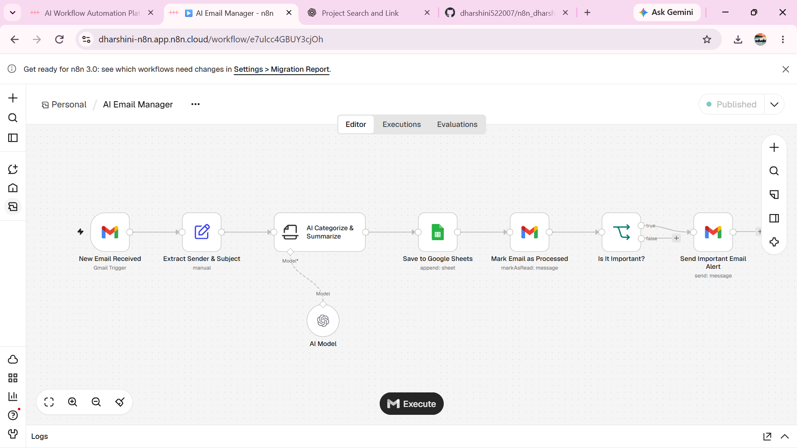

# 📧 AI Email Manager – Intelligent Email Automation

An AI-powered email management system built using **n8n workflow automation**, Gmail, OpenAI and Google Sheets to simplify email processing and automate repetitive email tasks.

## 🚀 Project Overview

AI Email Manager is an intelligent workflow automation project that automatically monitors incoming emails, extracts important information, classifies emails into different categories, generates summaries and stores the results in Google Sheets.

It also identifies important emails and sends automatic email alerts to help users stay updated.

## 🎯 Project Objectives

- Automate incoming email processing.
- Classify emails using AI.
- Generate short email summaries.
- Organize email information in Google Sheets.
- Identify important emails.
- Send automatic notifications for important emails.
- Reduce manual email management.

## 🛠️ Technologies Used

| Technology | Purpose |
|---|---|
| n8n | Workflow Automation |
| Gmail API | Email Integration |
| OpenAI | AI Classification and Summarization |
| Google Sheets | Data Storage |
| JSON | Workflow Configuration |
| Docker | Containerization support |

## ✨ Key Features

1. **Automatic Email Detection** – Detects unread incoming Gmail messages.
2. **Information Extraction** – Extracts sender name, email address, subject and message content.
3. **AI Email Classification** – Categorizes emails into Important, Personal, Promotional and Spam.
4. **Email Summarization** – Generates short summaries of email content.
5. **Google Sheets Integration** – Stores email details, categories and summaries.
6. **Automatic Email Processing** – Marks processed emails as read.
7. **Important Email Detection** – Identifies emails classified as Important.
8. **Email Alerts** – Sends automatic notifications for important emails.

## 🔄 Workflow Architecture

The automation follows this sequence:

1. New Email Received – Gmail Trigger
2. Extract Sender & Subject
3. AI Categorize & Summarize
4. AI Model Processing
5. Save to Google Sheets
6. Mark Email as Processed
7. Check Email Importance
8. Send Important Email Alert

## 📸 Workflow Screenshot



## 📂 Project Structure

```text
n8n_dharshini/
│
├── AI_Email_Manager_Workflow_Public.json
├── AI_Email_Manager_workflow.png
├── Dockerfile
└── README.md
```

## ⚙️ Installation and Setup

1. Install or access n8n.
2. Download the workflow JSON file from this repository.
3. Open your n8n workspace.
4. Import the downloaded JSON workflow.
5. Configure your Gmail credentials.
6. Configure your OpenAI credentials.
7. Connect your Google Sheets account.
8. Set your spreadsheet ID and notification email address.
9. Test the workflow with sample emails.
10. Activate the workflow after successful testing.

**Note:** Credentials and account-specific settings are not included in the public workflow export.

## 💡 Expected Benefits

- Saves time through automated email processing.
- Improves email organization.
- Makes important emails easier to identify.
- Reduces repetitive manual work.
- Provides structured email records.

## 👩‍💻 Author

**Dharshini Vijayakumar**

GitHub: [dharshini522007](https://github.com/dharshini522007)

## ⭐ Project Repository

Explore the complete project and workflow files:

[AI Email Manager – GitHub Repository](https://github.com/dharshini522007/n8n_dharshini)

---

*Built with n8n Workflow Automation and AI Integration.*
